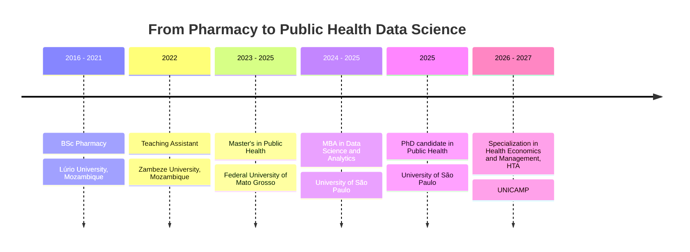

**Pharmacist by training. Epidemiologist by choice. Data person by habit.**

---

## Hello

I'm a PhD candidate in Public Health at the **University of São Paulo**, studying the epidemiology of diseases and health conditions and what determines them. I came to this field through Pharmacy in Mozambique, moved to Brazil for my Master's, and kept adding tools along the way: first epidemiology, then data science, now health economics.

Most days I'm writing R or Python, cleaning messy health data, and trying to answer one question: *what does the evidence actually say, and how sure are we?*

> Quantitative methods are only useful if someone can trust, reproduce and act on the result.

---

## Research focus

| | |
|---|---|
| **Chronic disease** | Non-communicable chronic diseases and their determinants |
| **Mothers and children** | Maternal and child health, infant mortality |
| **Medicines** | Pharmacoepidemiology, antimicrobial resistance |
| **Value for money** | Health economics and management, with a focus on Health Technology Assessment (HTA) |
| **Prediction** | Predictive modeling for health outcomes |

---

## Path so far

---

## Peer review

I review manuscripts for:

---

## Projects

### House price prediction with neural networks

A hands-on project to push regression with neural networks on tabular data. I started with a baseline, added regularization, then tuned hyperparameters with Keras Tuner and compared everything on MAE, RMSE and R².

| Metric | Tuned model (validation) |
|---|---:|
| MAE | 22,562.29 |
| RMSE | 35,632.88 |
| R² | **0.8345** |

`Python` `pandas` `scikit-learn` `TensorFlow` `Keras Tuner`

### Survival analysis and prediction in health *(in progress)*

Comparing classical survival models (Cox, penalized regression) with machine learning, judged on discrimination, calibration and clinical usefulness rather than accuracy alone. Code and papers will be linked here as they become public.

---

<b>Toolbox in detail</b>

 

| Area | What I use |
|---|---|
| Statistics | Regression, survival analysis, penalized models, model validation and calibration |
| Machine learning | scikit-learn, TensorFlow/Keras, hyperparameter tuning, explainability |
| Data work | pandas, NumPy, SQL, tidy R workflows |
| Reproducibility | Git, GitHub, Jupyter, documented pipelines |

<b>Away from the screen</b>

 

I read about social inequalities, development economics, data science and writing, and I follow what's new in epidemiology and health sciences. I also play chess. It rewards the same habits as research: patience, planning ahead, and admitting when a move was wrong.

---

### Let's talk

Epidemiology, HTA, pharmacoepidemiology or applied data science: if your work overlaps with mine, I'd like to hear about it.

