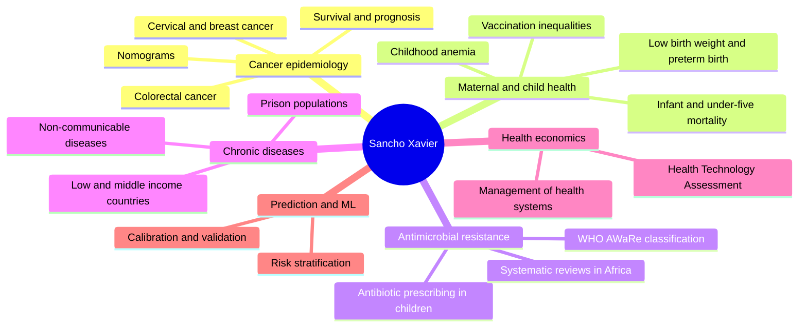
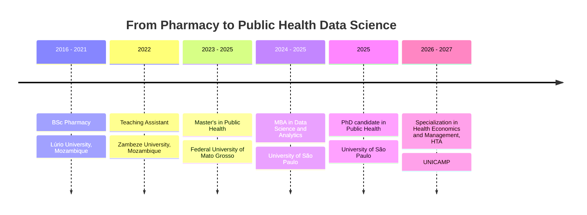

**Pharmacist by training. Epidemiologist by choice. Data person by habit.**

---

## Hello

I'm a PhD candidate in Public Health at the **University of São Paulo** (Faculty of Public Health), studying the epidemiology of diseases and health conditions and what determines them. I came to this field through Pharmacy in Mozambique, moved to Brazil for my Master's, and kept adding tools along the way: first epidemiology, then data science, now health economics.

Most days I'm writing R or Python, cleaning messy health data, and trying to answer one question: *what does the evidence actually say, and how sure are we?*

> Quantitative methods are only useful if someone can trust, reproduce and act on the result.

**Quick facts**

- Master's in Public Health (UFMT) and MBA in Data Science and Analytics (USP)
- Working across two settings: Brazil (cancer, maternal and child health, hospital data) and Mozambique and sub-Saharan Africa (child health, antimicrobial resistance, chronic disease)
- Teaching Assistant in Pharmacy at Zambeze University since 2022
- Reviewer for BMJ Open, PLOS Global Public Health, Scientific Reports, BMC Public Health and others

---

## Affiliations and research groups

| Group | Role in my work |
|---|---|
| **AI for oncologic prognosis**, Faculty of Public Health, University of São Paulo | Machine learning and survival models for cancer outcomes |
| **VigiCan UFMT**, Cancer Surveillance in Mato Grosso, Federal University of Mato Grosso | Cancer surveillance, incidence trends, hospital and population-based cancer data |
| **Zambeze University**, Faculty of Health Sciences (Pharmacy) | Teaching and collaboration on health research in Mozambique |

---

## Research interests

| Theme | What I study |
|---|---|
| **Cancer prognosis** | Survival and risk prediction in cervical, breast and colorectal cancer, using hospital and linked population-based data in Mato Grosso |
| **Maternal and child health** | Under-five mortality, low birth weight, preterm birth, childhood anemia, vaccination coverage and the social inequalities behind them |
| **Antimicrobial resistance and pharmacoepidemiology** | Antibiotic prescribing patterns in children, inappropriate use, the WHO AWaRe framework |
| **Non-communicable chronic diseases** | Prevalence and determinants across settings, from prisons in Mozambique to low and middle income countries |
| **Predictive modeling** | Nomograms, survival models and machine learning, always judged on discrimination and calibration |
| **Health economics and HTA** | Evidence for decisions about technologies and health services, now my formal training at UNICAMP |

---

## Data sources I work with

| Source | What it is | Used for |
|---|---|---|
| **DHS** | Demographic and Health Surveys | Child mortality, anemia, vaccination, nutrition in sub-Saharan Africa |
| **MIS** | Malaria Indicator Surveys | Household survey data alongside DHS in African countries |
| **DATASUS** | Brazilian national health information systems (mortality, births, hospital admissions) | Mortality, preterm birth, hospital outcomes |
| **INCA, RCBP** | Population-based cancer registries (Brazil) | Incidence, trends and survival |
| **FOSP, RHC** | Hospital-based cancer registry, Fundação Oncocentro de São Paulo | Stage at diagnosis, treatment and survival |
| **Linked administrative data** | Registry-to-mortality and other record linkages | Follow-up and outcome ascertainment |
| **Cohort and primary data** | Birth cohorts and cross-sectional field studies | Low birth weight, NCDs, alcohol use in pregnancy |

---

## Skills and toolbox

### Data science

| Area | Tools |
|---|---|
| **Programming** |    |
| **Machine learning** |  Penalized regression, tree ensembles, boosting, hyperparameter tuning, model explainability |
| **Deep learning and neural networks** |   Keras Tuner |
| **Data handling** |   tidyverse |
| **Data visualization** | ggplot2, matplotlib, seaborn, plotly, forest plots, Kaplan-Meier curves, calibration plots, nomograms |
| **Workflow** |    |

### Statistics and epidemiology

- **Survival analysis:** Kaplan-Meier, Cox proportional hazards, time-to-event modeling, nomograms
- **Prediction modeling:** logistic regression risk models, discrimination, calibration, internal validation
- **Study designs:** cross-sectional, retrospective hospital-based, population-based, cohort
- **Evidence synthesis:** systematic reviews and meta-analysis
- **Trends and forecasting:** temporal trend analysis, projections
- **Complex survey analysis:** weighted analysis of DHS and MIS data
- **Health economics:** Health Technology Assessment (in training)

---

## Selected publications

Full list on [ORCID](https://orcid.org/SEU-ORCID-ID). Selected work by theme:

### Cancer prognosis and surveillance

- Machine learning for predicting mortality in women with breast cancer in Mato Grosso, using linked cancer registry and mortality data. *PLOS One*, 2026. [DOI](https://doi.org/10.1371/journal.pone.0356621)
- Machine learning for risk stratification of in-hospital mortality in cervical cancer, Mato Grosso. *BMC Cancer*, 2026. [DOI](https://doi.org/10.1186/s12885-026-16771-z)
- Nomogram predicting overall survival in hospitalized cervical cancer patients in Mato Grosso. *Discover Oncology*, 2025. [DOI](https://doi.org/10.1007/s12672-025-02380-y)
- Nomogram model for long-term prognosis of cervical cancer patients: a population-based study in Mato Grosso. *BMC Cancer*, 2025. [DOI](https://doi.org/10.1186/s12885-025-14056-5)
- Time to death from cervical cancer and its predictors in hospitalized patients: a survival approach. *World Journal of Surgical Oncology*, 2024. [DOI](https://doi.org/10.1186/s12957-024-03518-y)
- Factors associated with advanced diagnosis of cervical cancer in the Brazilian Legal Amazon. *ecancermedicalscience*, 2025. [DOI](https://doi.org/10.3332/ecancer.2025.2045)
- Trend in cancer incidence in Mato Grosso and its health regions, 2001 to 2018. *Archives of Public Health*, 2025. [DOI](https://doi.org/10.1186/s13690-025-01503-9)
- Time to death from colorectal cancer in hospitalized patients: a survival study in the Legal Amazon. *Revista JRG de Estudos Acadêmicos*, 2026. [DOI](https://doi.org/10.55892/jrg.v9i21.3639)

### Maternal and child health

- Survival analysis of under-five mortality predictors, Mozambique DHS 2011 and 2022/23. *BMC Public Health*, 2026. [DOI](https://doi.org/10.1186/s12889-026-27197-4)
- Machine learning models for predicting childhood anemia in Mozambique. *BMC Pediatrics*, 2026. [DOI](https://doi.org/10.1186/s12887-026-06925-0)
- National and regional trends and forecasting of preterm birth in Brazil, 2014 to 2023, with projections to 2030. *BMC Pregnancy and Childbirth*, 2025. [DOI](https://doi.org/10.1186/s12884-025-08536-6)
- Predicting low birth weight risks in pregnant women in Brazil using machine learning (Araraquara cohort). *BMC Pregnancy and Childbirth*, 2025. [DOI](https://doi.org/10.1186/s12884-025-07351-3)
- Predictors of nutritional recovery time in children with severe acute malnutrition in Sofala, Mozambique. *Journal of Public Health*, 2024. [DOI](https://doi.org/10.1093/pubmed/fdae049)
- Social inequalities in child development: low birth weight trends in Brazil, 2010 to 2020. *Journal of Prevention*, 2024. [DOI](https://doi.org/10.1007/s10935-024-00768-0)

### Antimicrobial resistance and pharmacoepidemiology

- National and regional challenges of antibiotic prescribing in pediatric populations across Africa: systematic review and meta-analysis. *Systematic Reviews*, 2026. [DOI](https://doi.org/10.1186/s13643-026-03223-9)
- Antimicrobial resistance in Mozambique: the crisis we cannot afford to ignore. *The Lancet Regional Health, Africa*, 2026. [DOI](https://doi.org/10.1016/j.lanafr.2026.100053)
- An urgent call to combat antimicrobial resistance in sub-Saharan Africa through integrated and innovative solutions. *Discover Public Health*, 2025. [DOI](https://doi.org/10.1186/s12982-025-01083-7)
- Antibiotic prescribing patterns in pediatric patients using the WHO AWaRe classification, Nampula. *Scientific Reports*, 2024. [DOI](https://doi.org/10.1038/s41598-024-72349-4)
- Inappropriate use of antibiotics and its predictors in pediatric patients, Nampula. *Antimicrobial Resistance and Infection Control*, 2022. [DOI](https://doi.org/10.1186/s13756-022-01115-w)

### Chronic diseases, risk models and health policy

- A novel clinical nomogram for predicting unfavorable tuberculosis treatment outcomes. *Journal of Epidemiology and Global Health*, 2026. [DOI](https://doi.org/10.1007/s44197-026-00532-z)
- Prevalence and determinants of chronic non-communicable diseases among prison inmates in Tete, Mozambique. *BMC Public Health*, 2025. [DOI](https://doi.org/10.1186/s12889-025-24387-4)
- How do structural inequalities influence COVID-19 hospital mortality among traditional peoples and communities? São Paulo, 2021 to 2023. *BMJ Public Health*, 2026. [DOI](https://doi.org/10.1136/bmjph-2025-002679)
- Why are policies to combat undernutrition not effective in Mozambique? *Nature Communications*, 2026. [DOI](https://doi.org/10.1038/s41467-026-69040-9)

---

## Path so far

---

## Peer review

I review manuscripts for:

---

## Projects on GitHub

### House price prediction with neural networks

A hands-on project to push regression with neural networks on tabular data. I started with a baseline, added regularization, then tuned hyperparameters with Keras Tuner and compared everything on MAE, RMSE and R².

| Metric | Tuned model (validation) |
|---|---:|
| MAE | 22,562.29 |
| RMSE | 35,632.88 |
| R² | **0.8345** |

`Python` `pandas` `scikit-learn` `TensorFlow` `Keras Tuner`

### Survival and prediction code *(in progress)*

Reproducible pipelines for the survival and machine learning models behind my cancer and child health papers. Code will be linked here as it becomes public.

---

## Where I'm heading

**Research I want to build next**

1. **Externally validated survival models for infant mortality in Africa.** Machine learning models for child survival that are tested on data from other African countries, not only the one where they were trained. A model that works in one country and fails in the next isn't much use for policy.
2. **Systematic reviews of antimicrobial resistance trends.** Mapping how resistance is growing in the microorganisms that matter most clinically, and where the evidence is thin.
3. **Diabetes and hypertension.** Non-communicable chronic diseases, with a focus on prevalence, determinants and prediction.
4. **Health economics.** Bringing HTA into my prediction work, so models are judged not just on accuracy but on whether they change decisions and costs.

**Always on:** model calibration and clinical utility, explainable machine learning, and reproducible, open analysis.

---

<b>Away from the screen</b>

 

I read about social inequalities, development economics, data science and writing, and I follow what's new in epidemiology and health sciences. I also play chess. It rewards the same habits as research: patience, planning ahead, and admitting when a move was wrong.

---

## GitHub analytics

---

### Let's talk

If your work touches cancer epidemiology, child health, antimicrobial resistance, HTA or applied machine learning, I'd like to hear about it.

