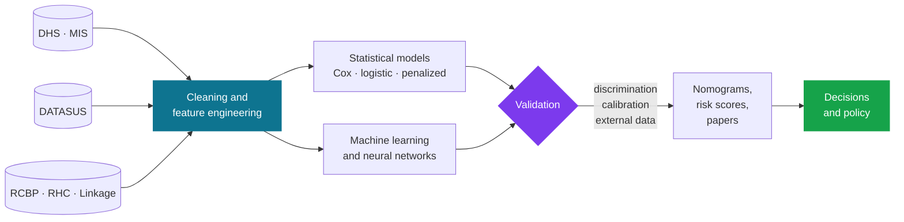
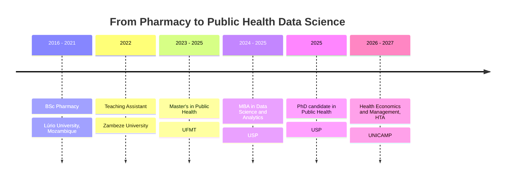

 

[**About**](#-about) · [**Research**](#-research-lines) · [**Data**](#-data-sources) · [**Toolbox**](#-toolbox) · [**Publications**](#-selected-publications) · [**Roadmap**](#-roadmap) · [**Contact**](#-contact)

 

 

<table align="center">
<tr>
<td align="center" width="25%"><h2>39</h2>works on ORCID</td>
<td align="center" width="25%"><h2>9</h2>journals reviewed for</td>
<td align="center" width="25%"><h2>2</h2>continents of data Brazil · Africa</td>
<td align="center" width="25%"><h2>3</h2>degrees + MBA + HTA in progress</td>
</tr>
</table>

---

## 👤 About

<table>
<tr>
<td width="62%" valign="top">

I'm a **PhD candidate in Public Health at the University of São Paulo**, where I study the epidemiology of diseases and health conditions and what determines them.

My path went from Pharmacy in Mozambique to a Master's in Public Health in Mato Grosso, then an MBA in Data Science, and now a PhD, with Health Technology Assessment on the side. Each step added a tool, and I still use all of them.

Most days I'm in R or Python, cleaning messy health data and asking: *what does the evidence actually say, and how sure are we?*

> Quantitative methods only matter if someone can trust, reproduce and act on the result.

</td>
<td width="38%" valign="top">

**Now**

- 🎓 PhD candidate, FSP-USP
- 📚 Specialization in Health Economics and HTA, UNICAMP
- 🧑‍🏫 Teaching Assistant, Pharmacy, Zambeze University
- 🔬 AI for oncologic prognosis · VigiCan UFMT

**Based in** São Paulo, Brazil
**From** Mozambique

</td>
</tr>
</table>

---

## 🧬 Research lines

<table>
<tr>
<td width="33%" valign="top">

### 🎗️ Cancer prognosis
Survival and risk prediction for cervical, breast and colorectal cancer using hospital and linked population-based data in Mato Grosso.

`survival` `nomograms` `ML`

</td>
<td width="33%" valign="top">

### 👶 Mother and child
Under-five mortality, low birth weight, preterm birth, childhood anemia and vaccination, and the inequalities behind them.

`DHS` `SINASC` `cohorts`

</td>
<td width="33%" valign="top">

### 💊 Antimicrobial resistance
Antibiotic prescribing in children, inappropriate use and the WHO AWaRe framework, with evidence synthesis across Africa.

`pharmacoepi` `meta-analysis`

</td>
</tr>
<tr>
<td width="33%" valign="top">

### 🫀 Chronic diseases
Prevalence and determinants of non-communicable diseases, from prisons in Mozambique to low and middle income countries.

`NCDs` `cross-sectional`

</td>
<td width="33%" valign="top">

### 🤖 Predictive modeling
Risk stratification where discrimination, calibration and clinical usefulness matter more than a high AUC.

`calibration` `validation`

</td>
<td width="33%" valign="top">

### 💶 Health economics
Evidence for decisions about technologies and health services. My formal training at UNICAMP.

`HTA` `management`

</td>
</tr>
</table>

---

## 🗄️ Data sources

| | Source | What it gives me |
|:-:|---|---|
| 🌍 | **DHS** | Demographic and Health Surveys: child mortality, anemia, vaccination, nutrition in sub-Saharan Africa |
| 🦟 | **MIS** | Malaria Indicator Surveys, used alongside DHS household data |
| 🇧🇷 | **DATASUS** | Brazilian national systems for mortality, births and hospital admissions |
| 🎗️ | **INCA · RCBP** | Population-based cancer registries: incidence, trends, survival |
| 🏥 | **FOSP · RHC** | Hospital-based cancer registry: stage at diagnosis, treatment, outcomes |
| 🔗 | **Linked administrative data** | Registry-to-mortality and other record linkages for follow-up |
| 🧪 | **Cohorts and field studies** | Birth cohorts and primary cross-sectional data |

---

## ⚙️ How I work

---

## 🧰 Toolbox

| | |
|---|---|
| **Programming** | R · Python · SQL |
| **Machine learning** | scikit-learn, penalized regression, tree ensembles and boosting, hyperparameter tuning, explainability |
| **Deep learning** | Neural networks with TensorFlow and Keras, Keras Tuner |
| **Statistics** | Kaplan-Meier, Cox models, logistic risk models, nomograms, calibration, complex survey analysis, trend forecasting |
| **Evidence synthesis** | Systematic reviews and meta-analysis |
| **Data visualization** | ggplot2, matplotlib, seaborn, plotly: Kaplan-Meier curves, forest plots, calibration plots, nomograms |
| **Workflow** | Git, GitHub, Jupyter, reproducible pipelines |

---

## 📄 Selected publications

Everything is on [ORCID](https://orcid.org/SEU-ORCID-ID). A selection by theme:

<b>🎗️ Cancer prognosis and surveillance</b>

 

| Year | Title | Journal | |
|:-:|---|---|:-:|
| 2026 | Machine learning to predict mortality in women with breast cancer, Mato Grosso (linked registry and mortality data) | PLOS One | [DOI](https://doi.org/10.1371/journal.pone.0356621) |
| 2026 | Machine learning for risk stratification of in-hospital mortality in cervical cancer | BMC Cancer | [DOI](https://doi.org/10.1186/s12885-026-16771-z) |
| 2026 | Time to death from colorectal cancer in hospitalized patients, Legal Amazon | Rev. JRG de Estudos Acadêmicos | [DOI](https://doi.org/10.55892/jrg.v9i21.3639) |
| 2025 | Nomogram for overall survival in hospitalized cervical cancer patients | Discover Oncology | [DOI](https://doi.org/10.1007/s12672-025-02380-y) |
| 2025 | Nomogram for long-term prognosis of cervical cancer, population-based | BMC Cancer | [DOI](https://doi.org/10.1186/s12885-025-14056-5) |
| 2025 | Factors associated with advanced diagnosis of cervical cancer | ecancermedicalscience | [DOI](https://doi.org/10.3332/ecancer.2025.2045) |
| 2025 | Trend in cancer incidence in Mato Grosso, 2001 to 2018 | Archives of Public Health | [DOI](https://doi.org/10.1186/s13690-025-01503-9) |
| 2024 | Time to death from cervical cancer and its predictors: a survival approach | World J Surg Oncol | [DOI](https://doi.org/10.1186/s12957-024-03518-y) |

<b>👶 Maternal and child health</b>

 

| Year | Title | Journal | |
|:-:|---|---|:-:|
| 2026 | Survival analysis of under-five mortality predictors, Mozambique DHS 2011 and 2022/23 | BMC Public Health | [DOI](https://doi.org/10.1186/s12889-026-27197-4) |
| 2026 | Machine learning models to predict childhood anemia in Mozambique | BMC Pediatrics | [DOI](https://doi.org/10.1186/s12887-026-06925-0) |
| 2025 | Trends and forecasting of preterm birth in Brazil, 2014 to 2023, projections to 2030 | BMC Pregnancy Childbirth | [DOI](https://doi.org/10.1186/s12884-025-08536-6) |
| 2025 | Predicting low birth weight with machine learning, Araraquara cohort | BMC Pregnancy Childbirth | [DOI](https://doi.org/10.1186/s12884-025-07351-3) |
| 2024 | Predictors of nutritional recovery time in severe acute malnutrition, Sofala | J Public Health | [DOI](https://doi.org/10.1093/pubmed/fdae049) |
| 2024 | Social inequalities in child development: low birth weight trends in Brazil | J Prevention | [DOI](https://doi.org/10.1007/s10935-024-00768-0) |

<b>💊 Antimicrobial resistance and pharmacoepidemiology</b>

 

| Year | Title | Journal | |
|:-:|---|---|:-:|
| 2026 | Antibiotic prescribing in pediatric populations across Africa: systematic review and meta-analysis | Systematic Reviews | [DOI](https://doi.org/10.1186/s13643-026-03223-9) |
| 2026 | Antimicrobial resistance in Mozambique: the crisis we cannot afford to ignore | Lancet Reg Health Africa | [DOI](https://doi.org/10.1016/j.lanafr.2026.100053) |
| 2025 | An urgent call to combat antimicrobial resistance in sub-Saharan Africa | Discover Public Health | [DOI](https://doi.org/10.1186/s12982-025-01083-7) |
| 2024 | Antibiotic prescribing in children using the WHO AWaRe classification, Nampula | Scientific Reports | [DOI](https://doi.org/10.1038/s41598-024-72349-4) |
| 2022 | Inappropriate use of antibiotics and its predictors in hospitalized children | Antimicrob Resist Infect Control | [DOI](https://doi.org/10.1186/s13756-022-01115-w) |

<b>🫀 Chronic diseases, risk models and policy</b>

 

| Year | Title | Journal | |
|:-:|---|---|:-:|
| 2026 | A novel clinical nomogram for unfavorable tuberculosis treatment outcomes | J Epidemiol Glob Health | [DOI](https://doi.org/10.1007/s44197-026-00532-z) |
| 2026 | Structural inequalities and COVID-19 hospital mortality among traditional peoples, São Paulo | BMJ Public Health | [DOI](https://doi.org/10.1136/bmjph-2025-002679) |
| 2026 | Why are policies to combat undernutrition not effective in Mozambique? | Nature Communications | [DOI](https://doi.org/10.1038/s41467-026-69040-9) |
| 2025 | Chronic non-communicable diseases among prison inmates in Tete, Mozambique | BMC Public Health | [DOI](https://doi.org/10.1186/s12889-025-24387-4) |

---

## 🧭 Roadmap

- [ ] **External validation in Africa.** Machine learning survival models for infant mortality that are tested on data from other African countries, not only where they were trained
- [ ] **Resistance trends.** Systematic reviews to understand how antimicrobial resistance is growing in clinically important microorganisms
- [ ] **Diabetes and hypertension.** Prevalence, determinants and prediction for key non-communicable diseases
- [ ] **HTA meets prediction.** Judging models by whether they change decisions and costs, not only by accuracy
- [x] Cancer prognosis models for Mato Grosso, published
- [x] Child health prediction with national survey data, published

---

## 🏛️ Affiliations and groups

| | |
|---|---|
| **AI for oncologic prognosis** | Faculty of Public Health, University of São Paulo |
| **VigiCan UFMT** | Cancer surveillance in Mato Grosso, Federal University of Mato Grosso |
| **Zambeze University** | Faculty of Health Sciences, Pharmacy (Teaching Assistant) |

**Peer reviewer for**

---

## 🎓 Path

---

## 🚀 Project spotlight

**House price prediction with neural networks.** A practice project in regression on tabular data: baseline model, regularization, then hyperparameter tuning with Keras Tuner, compared on MAE, RMSE and R².

| MAE | RMSE | R² |
|:-:|:-:|:-:|
| 22,562.29 | 35,632.88 | **0.8345** |

`Python` `pandas` `scikit-learn` `TensorFlow` `Keras Tuner`

Code for the survival and ML pipelines behind my papers will be added here as it becomes public.

---

## 📊 GitHub analytics

---

<b>♟️ Away from the screen</b>

 

I read about social inequalities, development economics, data science and writing, and I follow what's new in epidemiology and health sciences. I also play chess. It rewards the same habits as research: patience, planning ahead, and admitting when a move was wrong.

---

## Contact

If your work touches cancer epidemiology, child health, antimicrobial resistance, HTA or applied machine learning, I'd like to hear from you.

Turning data into evidence, and evidence into decisions.

